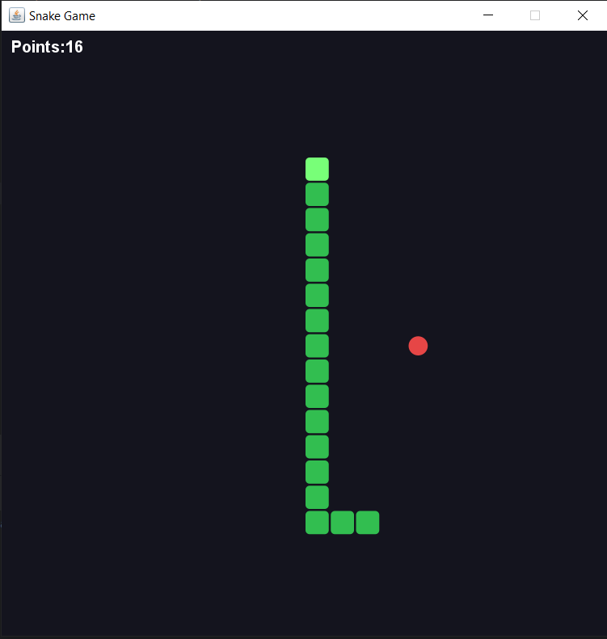
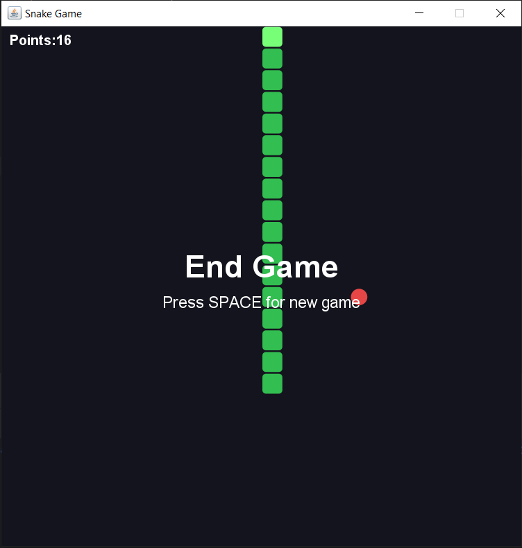

# 🐍 Java Snake Game

A classic Snake Game developed in Java using Swing and AWT, applying Object-Oriented Programming concepts and event-driven programming.

## 📌 About the Project

This project is a desktop implementation of the classic Snake game.

The player controls a snake using the keyboard, collects food to increase its size and score, and must avoid collisions with the walls and its own body.

The main goal of this project is to practice Java programming, data structures, graphical interfaces and application logic.

## 🚀 Features

- Snake movement using keyboard arrows.
- Random food generation.
- Collision detection with walls and the snake's body.
- Dynamic snake growth.
- Score tracking.
- Game Over screen.
- Restart functionality.

## 🛠️ Technologies

- **Java** — Main programming language.
- **Java Swing** — Graphical user interface.
- **Java AWT** — Graphics, colors, coordinates and keyboard events.
- **Git & GitHub** — Version control and source code hosting.

## 🧠 Concepts Applied

- Object-Oriented Programming (OOP).
- Classes, objects, inheritance and interfaces.
- Encapsulation and access modifiers.
- ArrayList and Point.
- Conditional structures and loops.
- Event-driven programming.
- Event handling with ActionListener and KeyListener.
- Timer for controlling game updates.
- Graphics2D for custom rendering.
- Random number generation.

## 🎮 How to Play

| Key | Action |
|---|---|
| ⬆️ Arrow Up | Move Up |
| ⬇️ Arrow Down | Move Down |
| ⬅️ Arrow Left | Move Left |
| ➡️ Arrow Right | Move Right |
| Space | Restart after Game Over |

## ⚙️ How to Run

### Prerequisites

- Java Development Kit (JDK 8 or later).
- An IDE such as IntelliJ IDEA, Eclipse or VS Code (optional).

### Running locally

1. Clone the repository:

   ```bash
   git clone https://github.com/JheanVB2003/java-snake-game.git
   ```

2. Navigate to the project directory:

   ```bash
   cd java-snake-game
   ```

3. Compile the source files:

   ```bash
   javac -d out src/model/SnakeGame.java src/Main.java
   ```

4. Run the application:

   ```bash
   java -cp out Main
   ```

Alternatively, open the project in your preferred Java IDE and run the `Main.java` class.

## 📸 Screenshots

### Gameplay



### Game Over




## 👨‍💻 Author

Developed as a personal project to improve my Java programming skills and strengthen my understanding of Object-Oriented Programming.

**GitHub:** JheanVB2003 (https://github.com/JheanVB2003)